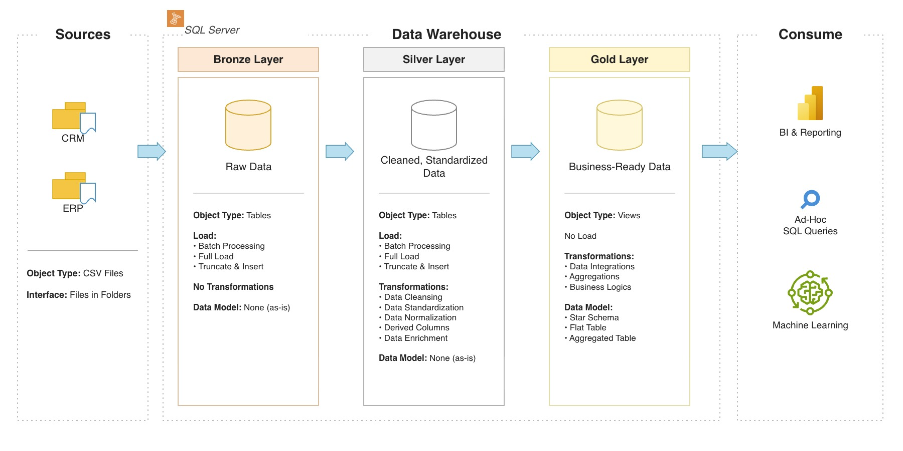
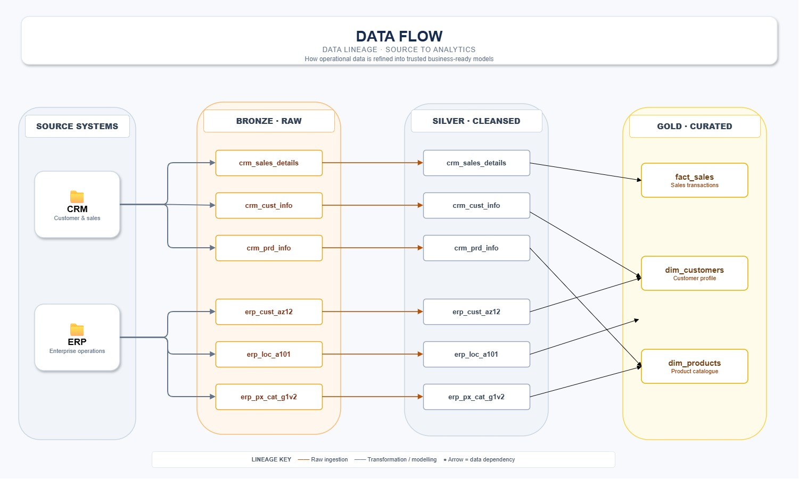
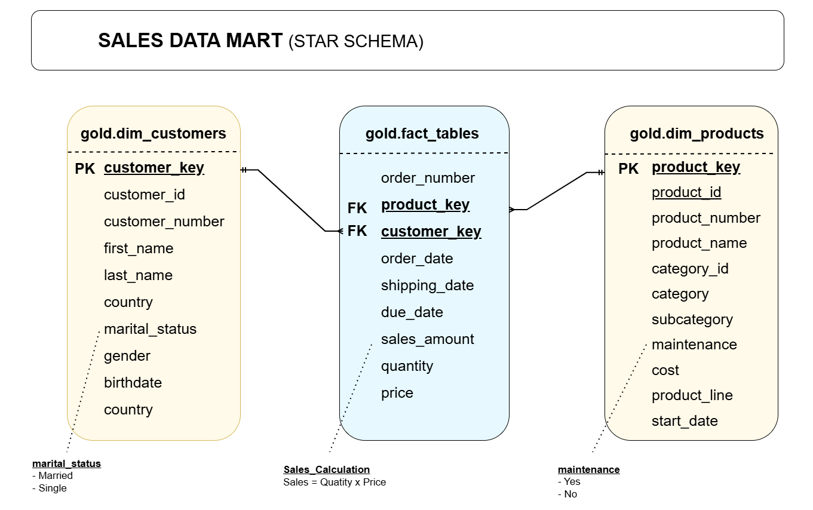

# Data Warehouse and Analytics Project

An end-to-end data engineering project: raw files from two source systems (a **CRM** and an **ERP**) are ingested, cleansed, integrated and modelled into a **SQL Server data warehouse** using the **Medallion architecture** (Bronze → Silver → Gold). The result is a clean, documented **star schema** that is ready for analytics and BI reporting.


>  **Full documentation:** [Project Walkthrough](docs/project_walkthrough.md) covers every design decision, transformation rule and validation step in detail.

---

## Table of Contents

- [Project Overview](#-project-overview)
- [Data Architecture](#-data-architecture)
- [Data Flow and Lineage](#-data-flow-and-lineage)
- [Data Model (Gold Layer)](#-data-model-gold-layer)
- [Repository Structure](#-repository-structure)
- [Tools and Technologies](#-tools-and-technologies)
- [Project Requirements](#-project-requirements)
- [Key Engineering Highlights](#-key-engineering-highlights)
- [Getting Started](#-getting-started)
- [Testing and Data Quality](#-testing-and-data-quality)
- [Analytics and Reporting](#-analytics-and-reporting)
- [Skills Demonstrated](#-skills-demonstrated)
- [Future Improvements](#-future-improvements)
- [About Me](#-about-me)
- [License](#-license)

---

## Project Overview

Businesses often hold their data in separate systems that each tell part of the story. This project consolidates sales-related data from two such systems into a single, trustworthy source of truth.

In this project I:

- **Designed the architecture:** a modern data warehouse with three layers (Bronze, Silver, Gold).
- **Built the ETL pipelines:** loaded the source files and moved the data through each layer with repeatable, logged stored procedures.
- **Cleansed and integrated the data:** resolved data quality issues and merged both sources into one consistent model.
- **Modelled the data:** created fact and dimension objects (star schema) designed for reporting.
- **Documented and tested everything:** diagrams, a data catalog, naming conventions and reusable quality-check scripts.

---

## Data Architecture

The warehouse follows the **Medallion architecture**:



| Layer | Purpose | Objects | Load | Transformations |
|---|---|---|---|---|
| **Bronze** | Raw data stored as-is from the source systems (CSV → SQL Server) | Tables | Batch, full load (truncate and insert) | None |
| **Silver** | Cleansed, standardised and normalised data | Tables | Batch, full load (truncate and insert) | Cleansing, standardisation, normalisation, derived columns, enrichment |
| **Gold** | Business-ready data modelled as a star schema | Views | None (virtual) | Integration, business rules, aggregation |

---

## Data Flow and Lineage



Every Gold object can be traced back through Silver and Bronze to its original source file. The lineage diagram makes impact analysis and debugging straightforward.

---

## Data Model (Gold Layer)

The Gold layer is a **star schema** with two dimensions and one fact table:



| Object | Type | Description |
|---|---|---|
| `gold.dim_customers` | Dimension | Customer details enriched with demographic and geographic data from both sources |
| `gold.dim_products` | Dimension | Current product records with category, subcategory, cost and product line |
| `gold.fact_sales` | Fact | Sales transactions linked to customers and products via surrogate keys |

Column-level descriptions are in the [Data Catalog](docs/data_catalog.md).

---

## Repository Structure

```
sql-data-warehouse-project/
├── setup/                   # Setup guide
├── datasets/                # The 6 source files the project loads
│   ├── source_crm/          #   3 files from the CRM system
│   └── source_erp/          #   3 files from the ERP system
├── docs/                    # Images, diagrams and documentation
│   ├── project_walkthrough.md
│   ├── data_catalog.md
│   └── *.png / *.drawio     #   architecture, data flow, integration and data model diagrams
├── scripts/                 # SQL scripts, in execution order
│   ├── init_database.sql    #   creates the database and schemas (run first)
│   ├── bronze/              #   DDL and procedure to load raw files
│   ├── silver/              #   DDL and procedure to cleanse and prepare data
│   └── gold/                #   views that build the star schema
├── tests/                   # Data quality checks for Silver and Gold
├── LICENSE
└── README.md
```

---

## Tools and Technologies

| Tool | Purpose |
|---|---|
| **SQL Server (Express)** | Data warehouse platform |
| **SQL Server Management Studio (SSMS)** | Development and query client |
| **T-SQL** | ETL logic, stored procedures, views, quality checks |
| **Git and GitHub** | Version control and portfolio |
| **draw.io** | Architecture, data flow, integration and data model diagrams |
| **Notion** | Project plan: epics, tasks and progress tracking |

---

## Project Requirements

### Building the Data Warehouse (Data Engineering)

**Objective:** develop a modern data warehouse using SQL Server to consolidate sales data, enabling analytical reporting and informed decision-making.

**Specifications**

- **Data sources:** import data from two source systems (ERP and CRM) provided as CSV files.
- **Data quality:** cleanse and resolve data quality issues prior to analysis.
- **Integration:** combine both sources into a single, user-friendly data model designed for analytical queries.
- **Scope:** focus on the latest dataset only; historisation is not required.
- **Documentation:** provide clear documentation of the data model to support business stakeholders and analytics teams.

### Analytics and Reporting (Data Analysis)

**Objective:** develop SQL-based analytics to deliver detailed insights into:

- **Customer behaviour**
- **Product performance**
- **Sales trends**

These insights give stakeholders the key business metrics they need for strategic decision-making.

---

## Key Engineering Highlights

- **Medallion architecture with separation of concerns:** each layer has one clear responsibility, and every source lands in Bronze first.
- **Repeatable, idempotent loads:** `TRUNCATE` + `BULK INSERT` stored procedures can be re-run safely without creating duplicates.
- **Observability built in:** per-table and total load durations, structured `PRINT` logging and `TRY…CATCH` error reporting.
- **Systematic data cleansing:** deduplication with window functions, trimming, standardising codes to readable values, handling NULLs, repairing invalid dates, and recalculating inconsistent sales values using business rules.
- **Cross-source integration:** a master-source rule resolves conflicting customer attributes between CRM and ERP.
- **Dimensional modelling:** surrogate keys, dimension-key lookups in the fact view, and a star schema built for BI tools.
- **Metadata columns:** `dwh_create_date` on every Silver table for auditing and traceability.
- **Consistent naming conventions:** `snake_case`, source-prefixed Bronze/Silver tables, and `dim_` / `fact_` prefixes in Gold.
- **Quality gates:** reusable test scripts validate uniqueness, formatting, standardisation, business rules and referential integrity.

---

## Getting Started

### Prerequisites

- SQL Server (Express edition is fine) and SQL Server Management Studio
- This repository cloned or downloaded

### Steps

1. **Place the source files.** The scripts read the six CSV files from `C:\sql\dwh_project\datasets\`. Put the `datasets/` folder there, or update the six file paths in `scripts/bronze/proc_load_bronze.sql`.
2. **Create the database and schemas** (⚠️ this drops and recreates `DataWarehouse`):
   ```sql
   -- scripts/init_database.sql
   ```
3. **Create the tables:** run `scripts/bronze/ddl_bronze.sql`, then `scripts/silver/ddl_silver.sql`.
4. **Create the stored procedures:** run `scripts/bronze/proc_load_bronze.sql` and `scripts/silver/proc_load_silver.sql`.
5. **Create the Gold views:** run `scripts/gold/ddl_gold.sql`.
6. **Run the pipeline:**
   ```sql
   EXEC bronze.load_bronze;
   EXEC silver.load_silver;
   ```
7. **Validate** with the scripts in `tests/` (each check is expected to return no rows).
8. **Query the Gold layer:**
   ```sql
   SELECT TOP 100 * FROM gold.fact_sales;
   ```

> Detailed instructions and the reasoning behind each step are in the [Project Walkthrough](docs/project_walkthrough.md).

---

## Testing and Data Quality

Quality checks live in `tests/` and are run after each load:

| Script | What it validates |
|---|---|
| `quality_checks_silver.sql` | Null/duplicate primary keys, unwanted spaces, standardised values, valid date ranges and order, business-rule consistency (`sales = quantity × price`) |
| `quality_checks_gold.sql` | Surrogate key uniqueness and referential integrity between the fact and dimensions |

---

## Analytics and Reporting

With the Gold layer in place, analysts can answer business questions directly with SQL or connect a BI tool such as Power BI or Tableau:

- **Customer behaviour:** who the customers are, where they are, and how they buy
- **Product performance:** which categories, subcategories and product lines drive sales
- **Sales trends:** performance over time, by period, region and segment

---

## Skills Demonstrated

`SQL (T-SQL)` · `Data Warehousing` · `ETL / ELT` · `Medallion Architecture` · `Data Modelling (Star Schema)` · `Data Cleansing and Quality` · `Data Integration` · `Window Functions` · `Stored Procedures` · `Error Handling and Logging` · `Data Lineage` · `Technical Documentation` · `Git / GitHub`

---

## Future Improvements

- Incremental loading (merge/upsert) in place of full loads
- Slowly Changing Dimension Type 2 for product history
- Audit table for load history and error logging
- Scheduling and orchestration (SQL Server Agent or an orchestration tool)
- Migrating the same design to a cloud platform

---

## About Me

Hi, I'm **Pujan Shrestha**, an aspiring **Data Engineer** with an MSc in Data Science and Computational Intelligence and a Master of Professional Accounting. I'm also an AWS Certified Solutions Architect – Associate. I enjoy building reliable data pipelines and turning messy data into something people can trust and use.

- LinkedIn: [linkedin.com/in/pujan-shrestha-742a38109](https://www.linkedin.com/in/pujan-shrestha-742a38109)
- Melbourne, Australia

Feedback and suggestions are always welcome. Feel free to open an issue or connect with me.

---

## License

This project is licensed under the [MIT License](LICENSE). You are free to use, modify and share it with attribution.
