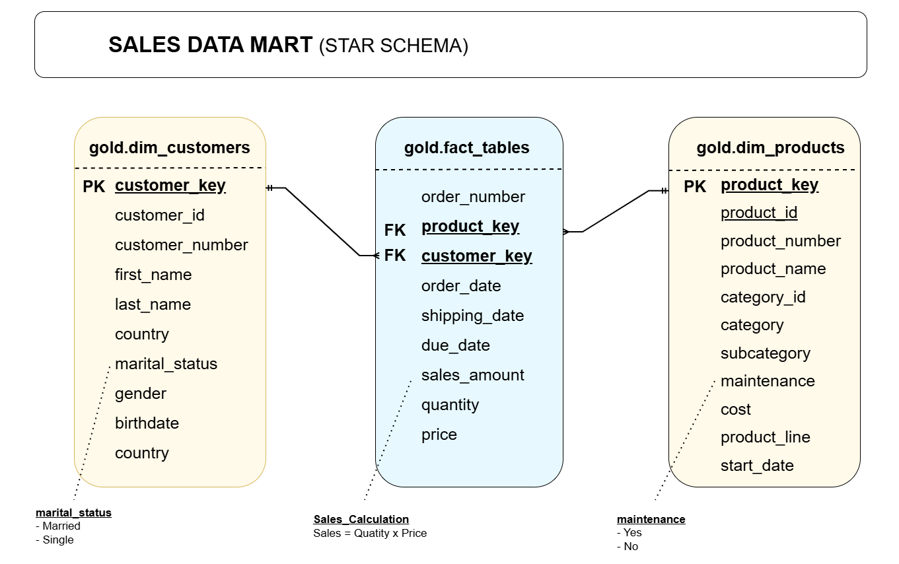

# Data Catalog: Gold Layer

The Gold layer is the business-level representation of the data, structured as a **star schema** (two dimensions and one fact) for analytics and reporting.

---

## 1. `gold.dim_customers`

**Purpose:** customer details enriched with demographic and geographic data from the CRM and ERP sources.
**Grain:** one row per customer.

| Column | Data type | Description |
|---|---|---|
| `customer_key` | INT | Surrogate key uniquely identifying each customer record in the dimension |
| `customer_id` | INT | Unique numerical identifier assigned to each customer |
| `customer_number` | NVARCHAR(50) | Alphanumeric identifier used for tracking and referencing the customer |
| `first_name` | NVARCHAR(50) | Customer's first name |
| `last_name` | NVARCHAR(50) | Customer's last name |
| `country` | NVARCHAR(50) | Country of residence (e.g. `Australia`); `n/a` if unknown |
| `marital_status` | NVARCHAR(50) | `Married`, `Single` or `n/a` |
| `gender` | NVARCHAR(50) | `Male`, `Female` or `n/a` (CRM is the master source; ERP is used as fallback) |
| `birthdate` | DATE | Date of birth (`YYYY-MM-DD`); `NULL` if invalid or unknown |
| `create_date` | DATE | Date the customer record was created in the source CRM |

---

## 2. `gold.dim_products`

**Purpose:** product attributes and classification. Current records only (no history).
**Grain:** one row per product.

| Column | Data type | Description |
|---|---|---|
| `product_key` | INT | Surrogate key uniquely identifying each product record |
| `product_id` | INT | Unique identifier assigned to the product in the source |
| `product_number` | NVARCHAR(50) | Structured alphanumeric product code, used to link to sales |
| `product_name` | NVARCHAR(50) | Descriptive product name, including type, colour and size |
| `category_id` | NVARCHAR(50) | Identifier linking the product to its category |
| `category` | NVARCHAR(50) | Broad classification (e.g. `Bikes`, `Components`) |
| `subcategory` | NVARCHAR(50) | More detailed classification within the category |
| `maintenance` | NVARCHAR(50) | Whether the product requires maintenance (`Yes` / `No`) |
| `cost` | INT | Base cost of the product |
| `product_line` | NVARCHAR(50) | `Mountain`, `Road`, `Touring`, `Other Sales` or `n/a` |
| `start_date` | DATE | Date the product became available |

---

## 3. `gold.fact_sales`

**Purpose:** transactional sales data for analysis.
**Grain:** one row per order line.

| Column | Data type | Description |
|---|---|---|
| `order_number` | NVARCHAR(50) | Sales order identifier (e.g. `SO54496`) |
| `product_key` | INT | Foreign key to `gold.dim_products.product_key` |
| `customer_key` | INT | Foreign key to `gold.dim_customers.customer_key` |
| `order_date` | DATE | Date the order was placed |
| `shipping_date` | DATE | Date the order was shipped |
| `due_date` | DATE | Date the payment was due |
| `sales_amount` | INT | Total value of the line item (`quantity × price`) |
| `quantity` | INT | Number of units ordered |
| `price` | INT | Price per unit |

---

## Relationships

| From | To | Cardinality |
|---|---|---|
| `dim_customers.customer_key` | `fact_sales.customer_key` | One (mandatory) to many (optional) |
| `dim_products.product_key` | `fact_sales.product_key` | One (mandatory) to many (optional) |

> Verify data types and example values against your final views before publishing.
